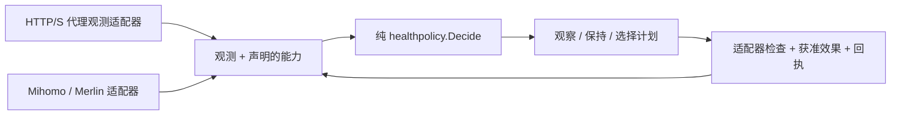

# 架构说明

> 中文版是英文 `docs/ARCHITECTURE.md` 的阅读映射；英文文件是项目真源。

本项目不是某一个路由器型号的专用笔记，而是一套按能力驱动、可迁移的家庭网络边缘代理生命周期协调器，不是只执行一次的初始化脚本；它能在重启或漂移后从观测状态重新进入流程。可复用决策策略应独立于产品配置、REST API 和设备路径，由适配器转换观测、能力与获授权的效果。Mihomo/Clash 文件是当前运行时适配器的格式，不是框架通用策略表示。首个已经实现的设备参考适配器面向官方 Asuswrt-Merlin 支持的华硕路由器，但不把项目绑定到某一个具体型号、固件族、服务商、运行时、UI 模板、controller 端口或某一套代理组命名。

## 分层

### 操作入口与宿主、设备隔离

启动流程分成通用项目定位/结构校验、宿主控制台/文件系统/桌面集成、设备专属操作三类职责。
通用启动不要求 `adapters/merlin`、`/jffs`、NVRAM 或正在运行的代理存在。设备能力缺失时，帮助与
本机入口设置仍可使用；选择缺少实现的操作时说明能力缺项，不假装另一种实现天然兼容。

`bootstrap.sh` 将候选探测交给可信、已安装适配器的 `detect.sh`，限制标识并仅调度普通入口文件。
没有候选或有多个候选时要求选择。Merlin 探测只是只读候选信号，不证明官方固件、型号或运行时通过
验收。既有设备流程仍使用当前参考实现，这是渐进隔离，不声称所有适配器已经实现。
条件判断、实例绑定和宿主证据见 [启动与恢复契约](LAUNCHER.md)。


TUI 的完整本机双语帮助与会话内语言切换独立于设备操作。安装观测绑定新的路由器／路径清单，不能用历史日志或运行时存在代替。已有项目默认诊断／复用；只有明确选择维护菜单 `7 → 1` 或快捷键 `R`，并依次确认 `REPLACE`、`APPLY` 才授权项目刷新，写者持锁后再次检查。仅项目范围排除运行时／core 载荷，但允许受管集成／配置变化。启动、执行操作前及重要工作前后检查结构、物理身份和所需工具；本机菜单导航、帮助和语言切换不运行这些探测，已知退化时保留帮助／语言／退出，不是后台故障探测器。

| 层级 | 文件 | 实际可移植边界 | 说明 |
|---|---|---|---|
| 纯服务健康策略 | `tools/yamlbridge/internal/healthpolicy` | 与产品无关的 Go 决策，无 I/O | 显式事实、证据范围、手动保持、能力、失败序列、冷却和写入预算 |
| 协议观测 | `tools/yamlbridge/service_proxy_observer.go` | 能运行原生工具的宿主，通过本机／私网标准 HTTP/S 代理 | 仅观察，不能绑定具名出站或切换它 |
| 运行时控制与配置 | `service_health.go`、`service_probe.go`、`config/policy.env`、`config/mihomo-overlay.yaml` | 当前 Mihomo／参考集成 | REST 图、`Edge-*` 组、内置 `GLOBAL`、配置格式与受保护写入均属适配细节 |
| 设备生命周期脚本 | `scripts/self-heal.sh`、`scripts/update-sub.sh`、`adapters/merlin/` | 当前 Merlin/ShellCrash 集成 | POSIX/BusyBox 语法不使其 REST、路径、cron、防火墙或生命周期行为成为运行时中立实现 |
| 离线载荷 | `bundle/` | 仅限声明的二进制架构与平台 | 格式或可执行文件兼容不等于其他适配器通过准入 |
| 物理前置 | 无 | 手工 | 刷固件、开 SSH、首次凭据仍是人工边界 |

### 产品中立的服务健康决策与具体适配器

现有服务健康驱动和 HTTP 代理观察器实际调用同一纯 `healthpolicy.Decide` 包。该包接收服务／路线／版本标识、观测、时间、先前记忆、所需证据范围及声明的能力，返回决策和下一份记忆；不包含网络、文件系统、Mihomo、`Edge-*`、`GLOBAL` 或路由器路径知识。它不执行选择，也不把调用方的能力声明当作证明。适配器仍负责新的来源观测、所有权／并发检查、持久化、执行、回滚与回执。具名出口、选择、手动保持或恢复能力缺失时，降为观察／保持，不虚构控制支持，也不要求用户更换产品。



| 已实现探测适配器 | 输入与范围 | 控制边界 |
|---|---|---|
| `http-proxy-observe` | 服务配置及显式 loopback／私网 IP 的 HTTP/S 代理 URL；无需内核、运行配置、节点图或路由器 | `route_binding=proxy_endpoint_only`、`egress_bound=false`、`frontend_only`；无自动选择或恢复 API |
| `mihomo-isolated`（旧探测请求的默认值） | 具体节点、源配置、Linux 内核及已经验证的绕行条件 | 可提供受限具名出站证据；生产控制仍归另行获授权的 Mihomo 驱动 |

该驱动的自动控制证据还有一道具体门槛：由 `loaded_binding_file` 引用的受控重载回执。当前绑定**仅支持 Mihomo v1.19.34 的 inline 代理实例**：一次确认重载后记录源文件摘要、core 身份、规范化 `GET /configs` 摘要和在线 inline 节点实例 ID，后续要求它们连续一致。实例 ID 是连续性令牌，不是节点参数哈希。回执缺失／陈旧、实例漂移、源文件／core／通用设置变化或其他内核版本，均降为 observe-only／unknown。重启或外部 reload 后须重新明确受控绑定，不根据同名节点或相同文件自动猜测。该绑定不为 `proxy-providers` 授予自动控制；`rule-providers` 的目标仍在静态规则中，因此可在其余所有权检查通过时使用。这不是通用的已加载配置 API 或账户可用性证明，也不升级独立固定的离线 core 载荷。

协议观察是实际存在的独立 CLI 观察路径，以固定 observe 模式和仅观察能力把结果交给同一策略，并用 `policy_action`、`policy_reason` 报告决策。由于不能绑定具名出口，有效观测仍保留 `egress_unbound` 策略原因。它不调用 Mihomo 控制循环，也不因共用策略实现而获得选择权限。协议观测可使用提供标准接口的既有客户端、服务器或网关，不要求指定客户端产品。仍须观测客户端本地代理／TUN／DNS 的优先关系。FlClash 只是当前客户端示例，不是框架依赖，也不是特殊兼容保证。其他设备提供观测端点，不意味着已实现第二套路由器安装、防火墙或控制适配器。具体观察请求及参考适配器配置见[服务分流](SERVICE_ROUTING.md)。

源码实现、夹具验证与目标验收是不同维度。源码包含纯策略及两种探测适配器；确定性策略和协议观察夹具检验其声明边界。夹具或本地测试结果不等于部署回执、跨宿主／设备验收，也不证明账户或模型生成。匿名探测尚无已登录 Gemini 地区异常的覆盖证明；认证探针尚未实现。每种实际运行时／客户端组合都须有自己的受限证据，才能扩大声明。

### Merlin 生命周期所有权

| 类别 | 表面 | 升级 / 回滚 | 项目退出 |
|---|---|---|---|
| 可替换 kit | `/jffs/home-edge-bootstrap` 与经过校验的项目事务变体 | 原子替换；可恢复上一版 kit | 删除 |
| 项目辅助脚本 | `/jffs/scripts` 下固定 `home-edge-*` 辅助脚本白名单 | 替换或从恢复 kit 重新应用 | 只删除白名单 |
| 共享注册 | 精确受管 `services-start` 块和 cron 名 `home_edge_selfheal` | 对精确项目条目做协调 | 只删除精确条目 |
| 操作者状态 | `/jffs/home-edge-bootstrap-state` 下订阅与本地策略 | 保留 | 保留 |
| 恢复状态 | 稳定根目录下订阅/运行时备份与生命周期证据 | 保留；仅通过显式恢复操作消费 | 保留并报告 |
| 可再生状态 | 稳定根目录下默认订阅缓存 | 可再生 | 删除 |
| 外部运行时 | `/jffs/ShellCrash`、Mihomo 内核与运行时自有配置 | 只由另行授权的运行时操作触碰 | 不触碰 |
| 固件/无关状态 | Asuswrt-Merlin、无关脚本、任务、服务和用户文件 | 项目不拥有 | 不触碰 |

固定删除边界写在经过审查的适配器代码中。来源证据可以佐证所有权，但目标元数据不能提供任意
待删除路径。

运行时存在性、controller 认证、Dashboard 配置、Dashboard 可达性、订阅凭据/缓存、live 订阅消费、路线验证、调度器注册、启动钩子注册和终端拓扑是相互独立的证据维度。任何一个维度健康都不能自动升级另一个维度。

## 敏感出口保障

敏感出口保障与日常可用性、自愈恢复属于不同能力类别。它的核心不变量是**敏感出口身份连续性**：在有明确时限的敏感操作窗口内，可观察到的路径所有者与有效叶节点必须保持一致；一旦发生变化，必须先使该窗口失效，再允许操作继续。可达、低延迟、地区标签或顶层选择组健康，都不能证明这一不变量。

未来的保障实现必须把出口身份建模为证据元组，而不是绑定服务商或节点名称。该元组至少需要包含运行时权威层、有效叶节点、出口地址族与观测出口、网络/ASN 分类、DNS 路径、策略代次和观测时间。它必须使用有时限的租约，在租约内抑制自动切换，检测漂移，并只对敏感流程执行失败关闭，不能因此中断无关的普通连接。租约也不能授权或代替账号、支付、注册、金融或地区验证操作。

当前自愈链路优化的是可用性与受限恢复，并不是敏感出口保障实现，现有路线健康证据也不得被表述为敏感出口保障。本版本只定义问题模型与负面契约；未来实现仍需独立夹具、隐私审查、操作者控制、过期行为和端到端拓扑证据。

## 适配器契约

以下契约用于未来适配器准入，也用于当前参考实现逐步完成隔离。框架应负责通用控制流，适配器负责目标特定集成。某个目标能够运行相似代理核心，并不意味着对应适配器自动取得支持声明。每个适配器都必须：

- 检测能力并报告不确定性，而不是只按产品名称判断；
- 在任何 apply 路径前提供只读诊断与 plan 行为；
- 写入必须明确确认，失败时保留最近的安全状态；
- 备份受管状态，并提供可执行回滚路径；
- 输出健康、来源和恢复证据，同时不泄露凭据；
- 把目标特定路径、服务管理、防火墙、DNS 和运行时约定收敛在适配器边界内；
- 提供版本化、幂等的迁移路径，保留存在差异的操作者状态，并在冲突时失败关闭；
- 提供先计划后应用的项目退出路径，使用固定所有权边界并报告保留状态；
- 提供离线夹具、明确兼容范围和具名维护责任人。

未来设备、固件和运行时工作只能通过能力、安全、恢复、证据、维护、迁移和项目退出契约接入。
未实现的适配器不是受支持目标，也不得在操作者说明中写成已支持。

框架复用成熟代理运行时与设备管理界面，不要求适配器重新实现代理核心、固件仪表盘或客户端 UI。

自动修复仅限项目自有文件、受管钩子块、cron 注册、缓存和受限选择器策略。运行时重启、Dashboard 安装、订阅信任/导入、防火墙/DNS、软路由配置和终端变更仍由适配器或人工把关，除非未来适配器证明了安全且可回滚的事务。

当前 Merlin 实现早于完整适配器隔离。`config/policy.env`、`scripts/self-heal.sh` 与 `scripts/update-sub.sh` 等通用文件仍保留 Merlin/JFFS/ShellCrash 默认值。这些默认值属于当前参考实现表面，不是可移植框架契约；其他适配器不得隐式继承。第二个适配器接入通用 apply 路径前，必须把这些默认值迁移到适配器提供的配置边界之后。

当前 Merlin 适配器会在 `services-start` 中安装带标记边界的受管块。该块调用项目自有 reconciler，恢复恰好一个 `home_edge_selfheal` cron 注册，并保留 `HEAL_CRON_DRY_RUN` 策略。常规协调不重启已运行的内核，也不修改防火墙/DNS；明确开启订阅自动化后，会恢复未接受的节点事务并注册独立的订阅任务。它不更换订阅供应方或安装新的 Dashboard。未来软路由工作是独立的适配器准入事项，不是这项 Merlin 事务的延伸。

Merlin 生命周期契约固定使用 `/jffs/scripts`。离线夹具即使采用替代 JFFS 根目录，`BOOTSTRAP_SCRIPT_DIR` 仍必须等于 `BOOTSTRAP_JFFS_DIR/scripts`。早于 reconciler 的部署属于升级对象，必须重新运行适配器；注册修复辅助脚本仅用于 reconciler 已部署、但钩子或 cron 已漂移的情形。

## 适配器生命周期

适配器成熟阶段与目标支持分类是两个不同维度。成熟阶段描述适配器实现在仓库中的治理与证据状态；`supported`、`unknown`、`unsupported` 等目标支持分类，则描述该适配器对某一个目标的判断。当前 Merlin 实现承担项目参考实现角色；在正式准入记录和更广泛发布/证据门仍不完整时，不声明其已取得本生命周期中的“已验证”成熟阶段。

| 阶段 | 含义 | 仓库姿态 |
|---|---|---|
| 外部集成 | 相关项目应用框架契约或受其启发 | 链接或记录互操作方式；不产生仓库内支持声明 |
| 实验性适配器 | 已有边界明确的实现，但证据或维护责任尚不完整 | 独立命名空间、明确实验标签、无默认 apply 路径 |
| 社区适配器 | 已有维护者、夹具、文档和声明的兼容范围 | 社区维护；支持声明严格限于已有证据 |
| 已验证适配器 | 在声明范围内通过完整安全、回滚、隐私、可移植性和发布门 | 可进入一等引导流程与发布支持 |

如果许可证、维护方式或发布节奏不同，保持外部集成可能比合并更安全。是否接纳取决于证据与可持续维护责任，而不是只看流行度或实现原理是否相似。

## 运行原则

路由器代理配置完成前，不能依赖代理专用下载。恢复可用边缘代理所需的内容，必须满足以下条件之一：

- 已在 `bundle/` 中；
- 路由器上已经存在；
- 可在本地网络或直连网络中获取。

GitHub 在中国大陆某些网络下可以直连访问，但速度和稳定性受网络环境影响，也可能阶段性中断。因此，GitHub 托管的发布资产可以作为可选准备来源，但不能成为代理建立前主流程的必需输入。本地 `check-no-wall-readiness` 脚本只检查已经存在的内容，不访问网络。

## 目标流程

1. 人工完成必要前置：固件、局域网访问、SSH。
2. 将本工具包复制到路由器。
3. 先以 plan 模式运行适配器。
4. 确认计划后再以 apply 模式运行。
5. 验证已配置的探测目标和至少一个与操作者实际用途相关的外部目标。
6. 接受 DRY-RUN 证据后，启用并验证自愈调度器及其重启恢复钩子。订阅刷新仍是显式人工动作；当前实现没有为它安装定时任务。

## 运行时发现模型

服务商配置可能呈现类似这样的组链路：

```text
主选择组 -> 可选地区或策略组 -> 可达具体路线
```

具体标签不是项目契约。脚本会自动发现 Mihomo controller，并按角色/名称启发式推断主可选代理组；如果某个配置结构比较特殊，可通过 `HEAL_GROUP`、`HEAL_GROUP_MATCH_REGEX` 和 `CLASH_API` 显式覆盖。


### 已实现的节点更新事务

参考实现新增 `subscription-auto.sh`：周期、按需、手动触发共享入口和全局写锁，
节点数据单独更新，本地策略/规则保持；隔离校验、同步重载确认、选择恢复和网络验证
成功后才接受事务。受管启动块先恢复未接受的持久配置，再协调订阅任务和原启动助手。
这项明确开启的事务扩展了此前仅缓存/人工导入的范围；它不授权自动更换供应方、
公开转换凭据、修改固件或防火墙。现有手动导入与旧缓存证明仍保持原来的证据边界。
